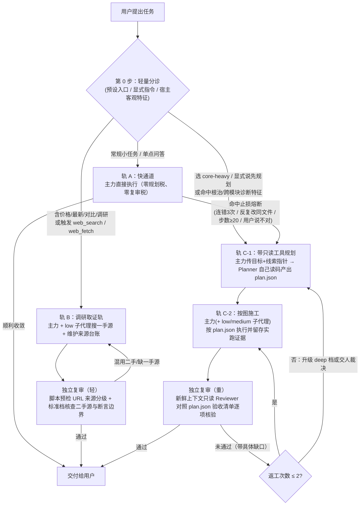

# dsh-tiered-workflow · 整体工作流架构设计（V2 蓝图）

> 状态：**设计已定稿（未实现）** · 编写日期：2026-11-24
> 适用平台：DSH `>= 0.2.1-rc.2`（PTC 模式）
> 演进关系：本插件当前包名/目录仍为 `dsh-expert-bridge`（`0.2.x` 运行态），计划演进并更名为 **`dsh-tiered-workflow`**（见第 6 节迁移计划）。

---

## 1. 背景与定位转向

### 1.1 为什么从「专家求助桥」转向「分档分工工作流」

`0.1.x` / `0.2.x` 阶段的核心假设是「主力弱模型自己干，卡住后被长尾提醒点醒，主动写求助包调用 `ask_expert`」。但生产实测直接证伪了这条路径：

| 实测事实 | 数据 / 现象 | 对架构的直接约束 |
|---|---|---|
| **提醒机制零转化** | 累计 2,550 次工具调用、单回合最高 224 次、47 次阈值提醒真实注入 **26 次**，生产 `ask_expert` 调用 **0 次** | 放弃「靠人设与注入提醒求弱模型自觉」；关键转段必须改为**宿主级硬门禁** |
| **提醒后改问用户** | 诊断会话 `6c73423f`（20 步 / 30 万思考字符）触发提醒后仍未调 `ask_expert`，反而转调 `ask_user_question` | 熔断阻断必须直接给出**可执行动作指令**，收窄允许的工具面 |
| **不是不动手，而是判断门槛低** | 调研会话 `96e81472`（36 查询 / 15 抓取 / 42 万思考字符）把一手官方定价与羊毛博客混用，且主力自查未拦截 | 调研类任务需**来源分级台账 + 独立复审**，不能依赖主力自审 |
| **`ask_expert` 看不到文件** | 纯文本单轮 `llm.stream` 无工具，被迫让判断力本就弱的主力手写 600 字求助包，易遗漏关键现场 | 复杂规划与复审改由**带只读工具的独立子代理**自己读代码/日志 |
| **预算敏感且模型会轮换** | 除配置注释说明 `minimax-code` 不计费外，其余路由单价未知；主力未来可能切换（如 `gemini 4 neon`） | 默认不收「强模型开局税」；路由必须按**职能角色 + 推理档位 + tag** 与具体模型名解耦 |

### 1.2 核心设计原则

1. **便宜主力承接 80% 常规活，强脑只花在「定方向」和「把关」两刀上**：默认快通道零额外税，靠客观特征快筛与中途熔断按需升级。
2. **用确定性代码替代不可靠的“模型自觉”**：流程状态、门禁阻断、结构校验全部下沉到宿主插件与 JSON Schema；预设人设回归极简。
3. **同一模型按推理强度（`reasoningEffort`）视为不同能力档位**：支持平滑梯度升级（先升推理强度，再换更贵模型）。
4. **先观测再调优**：不编造单价，完工后基于真实任务的 token 消耗、耗时与用户纠正次数做实测验收。

---

## 2. 与 `/swarm`、`/teamwork` 及重总控编排的边界对比

本框架不是为了替代大规模多代理团队协作，而是补齐「低预算日常开发与调研底座」：

| 维度 | `dsh-tiered-workflow`（本框架） | `/swarm` & `/teamwork`（及 `dsh-agent-teams`） | 重总控 / Superagent 编排范式 |
|---|---|---|---|
| **核心矛盾** | 预算受限下，如何让便宜主力稳定干活且不翻车 | 大型工程的多分支并行吞吐与长时自治 | 端到端统一理解、拆解与多技能调度 |
| **对中枢的假设** | **不信任中枢自觉** → 用宿主硬门禁兜底 | **假设协调者与成员都很强** → 公共消息板自由协作 | **高度依赖顶层总管极强** → 换弱模型即退化 |
| **成本特征** | 默认零额外税，按特征或熔断按需请强脑 | 高并发高消耗（多独立会话 + worktree） | 每单先过强总控，开局固定开销高 |
| **协作形态** | 垂直漏斗型：`只读强规划 → 便宜施工 → 只读独立复审` | 水平网状型：多常驻成员并行改动、互审、合并 | 中心辐射型 / 通用工作流引擎 |
| **典型场景** | 日常高频开发、排障、联网比价与资料调研 | 跨模块大型并行开发、长时间重构攻坚 | 跨系统长链路托管自动化 |

---

## 3. 核心架构：4 角色 × 能力档位 × 3 轨道 × 3 门禁

### 3.1 角色模型池与「模型 × 推理强度」能力档位

路由的最小配置单元不再是单纯的 `(provider, model)`，而是 **Model Profile（能力档位）**：

```ts
type ModelProfile = {
  name: string              // 人类可读档位名，如 "opus-mid" / "opus-max" / "kimi-mid"
  provider: string
  model: string
  reasoningEffort?: string  // 一等路由维度：low | medium | high | xhigh | max | ""
  maxTokens?: number        // 单档输出上限覆盖（可选）
  tier?: 'standard' | 'deep'// 升级阶梯标签：常规档 vs 攻坚档
  tags: string[]            // 领域标签，如 ["规划", "诊断", "复审", "审美"]
  note?: string
  systemPrompt?: string     // 仅顾问/规划/复审角色可选附加提示
}
```

全系统按职能划分为 **4 个角色槽位**，全部在插件设置页由人工配置，代码与提示词不写死任何具体模型名：

| 角色槽位 | 承担职责 | 权限隔离 | 典型配置示例（仅示意，按实际成本自配） |
|---|---|---|---|
| **主力（Main）** | 会话头模型：承接对话、快通道施工、按计划执行与最终交付 | 完整读写/执行（受宿主硬门禁约束） | 当前 `deepseek-v4.1-flash`，未来可无缝切 `gemini 4 neon` |
| **杂活工（Worker）** | 异步子代理（`delegate`）：并发搜索、目录整理、独立子模块读写 | `low` = 真只读隔离；`medium` = 可读写 | `low`：`MiniMax-M3.1-Flash`（不计费）；`medium`：同级次主力 |
| **规划 / 复审器（Planner / Reviewer）** | 带只读工具的子代理（`request_plan` / `request_review`）：自己读文件/查来源，输出结构化计划或验收报告 | **真只读隔离** + `maxDepth: 1`（禁改文件、禁套娃） | 支持「一模多档」：<br>- 标准档：`kimi-k3.1-pro (medium)` / `opus (medium)`<br>- 攻坚档：`kimi-k3.1-pro (max)` / `opus (high/max)` |
| **纯文本顾问（Advisor）** | 保留现有 `ask_expert`：无需读大段代码时的纯设计、审美、方向取舍快问 | 无工具（纯文本单轮 `llm.stream`） | `claude-opus-5-5`（`tags: ["审美", "设计"]`） |

**升级阶梯（Escalation Ladder）**：
* 触发规划或复审时，主力只传语义参数 `depth: 'normal' | 'deep'` 与可选 `need` 标签，不指定具体模型名。
* 常规任务默认匹配 `standard` 档（中等 `reasoningEffort`）；当返工失败、连续熔断或用户指定攻坚时，自动升档到 `deep` 档（高/`max` `reasoningEffort` 或顶配模型）。

---

### 3.2 极简基座预设体系

替代现有的重型 `dispatch`（18,351 字）与混杂协议的 `dispatch-m3`（1,470 字），拆分为 **2 个用户入口预设 + 2 个内部子代理预设**：

| 预设 ID | 用途 | 人设规模 | 职责边界 |
|---|---|---|---|
| **`core-v1`**（默认入口） | 80%+ 日常会话 | **~500 字** | **只保留**：① PTC `run_code` 与异步子代理基本事实；② 四类工具的一句话分工（自己干 / `delegate` / `request_plan` / `ask_expert`）；③ 3 条行为红线（改前先读、易变事实必须一手源否则标 `UNKNOWN`、不可逆操作先问人）。<br>**全部移除**：三分诊长文、R-HELP 规则、求助包格式、自查说教（全部下沉到插件与门禁）。<br>**必带插件**：`time-context`、`agent-instructions`、全套 PTC 工具、本插件。 |
| **`core-heavy`**（攻坚入口） | 开局即明确是复杂工程/疑难根治时手选 | 同 `core-v1` + 1 句 | 唯一差异：会话启动即标记初始轨道为 **轨 C（规划优先）**，跳过快通道直接走规划闭环。 |
| **`worker-readonly`**（内部，`order: 90`） | 供 `low` 杂活工、Planner、Reviewer 使用 | ~200 字 + 插件自动注入精简 preamble（~1.5 KB） | 只挂载只读工具（`tool-fs: { read: true, readImage: true, write: false, edit: false }` / `grep` / `glob` / `web_search` / `web_fetch`），**不挂载 shell/写工具，也不挂载 `dsh-agent-instructions`**（每轮立省 ~44 KB 全量 `AGENTS.md` 系统提示）；另由插件 `tools.guard` 按只读 `childId` 集合兜底硬拒继承自全局层的写入/委派工具。 |
| **`worker-exec`**（内部，`order: 91`） | 供 `medium` 施工子代理使用 | ~200 字 + 插件自动注入精简 preamble（~1.5 KB） | 挂载标准读写与命令工具，不挂全量 `agent-instructions`；由插件自动注入环境事实 preamble 与最小 P0 红线摘要，人设强调必须带正文与实跑证据收尾。 |

---

### 3.3 三轨任务流与渐进分诊

分诊采用 **「人工可选入口 + 宿主零成本快筛 + 试错止损自动升档」** 的混合策略——既不要求用户每次准确预判复杂度，也不对简单任务收强模型开局税：



**分诊细则**：
* **人工介入极简**：平时默认只用 `core-v1`；明知是大活就选 `core-heavy` 或在首句说「先规划」；任何时候想跳过流程直接干，说一句「跳过规划/直接改」即可解除门禁。
* **轨 A 容许低成本试错，严禁无限打转**：小问题允许弱主力便宜跑完；一旦触碰客观熔断阈值，立刻强转入轨 C，不浪费几十万字符空转。
* **轨 B 针对性根治调研翻车**：一旦进入联网调研，重点不是让强模型空写计划，而是强制记录一手/二手来源并在交付前核查。

---

### 3.4 Planner（可续聊）与 Reviewer（新鲜隔离）契约

基于 DSH `0.2.1-rc.2` 底层 `dsh-subagent` 原生支持 `agentPreset`、`outputSchema`、`maxDepth`、`delivery: 'caller'` 以及持久化 `continuable child`（`sendMessage` + `coldResume`），规划与复审的生命周期做**刻意分化**：

#### A. Planner（规划器）—— 同任务内「可续聊 + 轮次上限」

* **工具接口**：`request_plan({ mode: 'new' | 'followup', goal?, pointers?, feedback?, evidence?, depth?: 'normal' | 'deep', need? })`
* **主力不再手写 600 字求助包**（基于 V5 实测确立的 **V5-A 契约**）：
  * **首轮（`mode: 'new'`，同步直返）**：主力只需传入用户原始目标（`goal`）和已知路径/报错线索（`pointers`）。插件以 `worker-readonly` 预设 + `outputSchema: PlanSchema` + `delivery: 'caller'` + `maxDepth: 1` 拉起 Planner 子代理，由 Planner **自己读代码、查日志**，调用 `structured_output` 立即结束（自带 `concludeTurn`，省一轮多余收尾）并同步返回结构化 `plan.json`；插件自动落盘 `plan.md` 并将 `plannerChildId` 记入当前任务状态。
  * **续聊（`mode: 'followup'`，异步原生回执，避免重复注入）**：施工中途遇阻时，主力传入卡点与实跑输出（`feedback` + `evidence`），插件通过 `subagents.sendMessage` 发回**同一个 `plannerChildId`** 触发 `coldResume`。
    * *V5 实测约束*：`coldResume` 会完整保留历史对话、`provider/model/reasoningEffort` 与 `worker-readonly` 只读预设，但**不会恢复 `outputSchema` 且 `delivery` 会回落为 `'parent'`**。因此续聊 prompt 要求以 `json` 代码块输出修订版计划，工具立即返回 `{ status: 'followup_dispatched', childId }`，由原生 `subagent-settled` 通知唤醒父会话，同时插件监听 `subagent/end` 自动解析校验并更新 `plan.json`（既吃 Prompt Cache、免重读文件，又彻底避免双份重复注入）。
* **防思路僵化硬上限**：同一 `plannerChildId` 最多连续追问 **3 轮**（可配置）。超过 3 轮仍未收敛，强制清零重开新窗口并自动将 `depth` 升为 `deep`（仅携带精简的「已证伪结论清单」重新审视现场），打破沉没成本锚定。
* **`plan.json` 必填四要素**：
  1. `rootCauseOrScope`：根因假设或问题边界界定（禁止只治表象）
  2. `steps[]`：分步施工单（可标明建议自做 / `delegate(low)` / `delegate(medium)`）
  3. `evidencePlan[]`：证据计划（哪些易变断言必须查一手源、哪些结论需实跑输出）
  4. `acceptanceCriteria[]`：客观验收清单（具体检查命令、预期结果、禁止触碰边界）

#### B. Reviewer（复审器）—— 刻意保持「新鲜一次性上下文」

* **工具接口**：`request_review({ scope: 'research' | 'engineering', summary, artifactPaths, commandEvidence, depth?: 'normal' | 'deep', need? })`
* **为什么不复用 Planner 窗口**：复审的核心价值在于**零沉没成本、不被长篇施工思考催眠**。每次复审都用 `worker-readonly` 开干净新窗口，只读取四件硬证据：**原始需求 + `plan.json` 验收清单 + 实际改动 diff / 报告原文 + 实跑命令输出**。
* **轨 B（调研）两级省钱复审**：
  1. **零成本代码预检**：插件脚本先扫交付文本中的 URL 域名与断言标注，发现疑似无标注二手站（博客/论坛/羊毛站）或日期/价格无来源断言直接打回；
  2. **标准档独立核查**：通过预检后再由标准档只读子代理抽核关键断言与一手源是否真一致。
* **结构化输出（`review.json`）**：`verdict: 'pass' | 'fail'`、`checkedCriteria[]`、`gaps[]`（逐条写明缺口与修复动作）。未通过时退回主力返工，连续返工 2 次仍未通过则升级 `deep` 档或连同缺口清单交由用户裁决。

---

### 3.5 三道宿主级硬门禁与逃生阀

由插件在 `ctx.tools.guard` 中基于当前会话状态机执行。**关键原则：拒绝文案必须写成「下一步调用哪个工具、传什么参数」的明确动作指令，而不是抽象报错。**

| 门禁 | 生效范围 | 阻断条件 | 放行动作 | 解决的痛点 |
|---|---|---|---|---|
| **门禁 1 · 规划门禁** | 轨 C | 未生成有效 `plan.json` 前，拦截所有写入/修改型工具（`write`/`edit`/写操作），放行只读探查工具 | 调 `request_plan(mode:'new')` 成功落盘 `plan.json` | 根治不找根因直接表层打补丁（`6c73423f`） |
| **门禁 2 · 止损熔断门禁** | 全轨道 | 对齐全局 `AGENTS.md` §12 熔断标准，替代原 47 次软提醒：单回合工具调用满阈值（初设 **20 次**），或同文件/同命令连续失败 **3 次**打转时，**硬拒绝下一次普通工具调用** | 调 `request_plan` / `ask_expert` / `ask_user_question` 之一后自动重置计数 | 根治「26 次提醒 0 转化」与单回合 224 次空转 |
| **门禁 3 · 交付复审门禁** | 轨 B / 轨 C | 未获 `review.json` 通过前：① `tools.guard` 拦截交付/落盘动作；② **`agent/turn-stopping` + `agent.steer()` 拦截纯文本直接收尾**（带 `maxResumes: 2` 上限，且 `source.kind` 必须为插件专属名如 `dsh-tiered-workflow-review-gate`，严禁使用 Format v4 禁止的 `"plugin"`） | 调 `request_review` 返回 `pass`（或达重试上限后放行并记入未复审指标） | 根治混用低质源与主力自审失效（`96e81472`） |

**人类逃生阀（Human Override）**：
* 任意门禁均不锁死用户。用户在对话中明确回复「跳过规划 / 跳过复审 / 直接改」，状态机立刻置位放行并记入观测日志。

---

### 3.6 与全局 `AGENTS.md` 的协同与去重规则

为避免本框架与常驻全局规则（`C:/Users/NaE/.agents/AGENTS.md`，29.6 KB）及项目规则（16.3 KB）叠床架屋或相互打架，确立四条协同边界：

1. **§1 任务分类 & §3 Grill Me 与三轨对齐（防二次确认）**：
   * 全局「诊断/求助（≤3 步只读，不 Grill）」→ 主力先做 ≤3 步探查；定位且小改走轨 A，3 步未定根因或需根治自动进轨 C 调 `request_plan`；
   * 全局「问答（含价格/最新/对比）」→ 轨 B（一手源台账 + 独立复审）；
   * 全局「执行任务（小改）」→ 轨 A，按 §3 简短确认后施工；
   * 全局「执行任务（复杂/跨文件）」→ 轨 C，**由 Planner 产出的 `plan.md`（含验收标准）直接作为 §3.3 的分析方案交用户一次确认开工**，绝不“先被弱主力 Grill 一轮、同意后再被 Planner 规划一轮”。
2. **§12 止损熔断（P0）机械化**：门禁 2 直接执行 §12 口径（连续失败 3 次 / 单回合 20 次工具调用 / 观测单步思考暴涨），不再维护两套不同数字。
3. **§13.5 子代理环境 preamble 自动注入**：由插件在拉起子代理时自动读取并前置精简版 `subagent-task-preamble`（~1.5 KB）与最小 P0 安全摘要，替代让弱主力手动抄写，同时内部子代理预设不挂载全量 `dsh-agent-instructions`（立省 ~44 KB/轮）。
4. **§7 产物落点一致**：人类可读 `plan.md` 写入任务锚点目录 `tasks/<任务名>/`；插件状态与观测流水账落在 `$DSH_HOME/storages/`，不污染工作区根目录。

---

## 4. 轻量状态机与可观测验收体系

### 4.1 会话状态文件

每个会话维护一份轻量状态（如 `$DSH_HOME/storages/workflow-state/<session-id>.json`）：

```json
{
  "sessionId": "session-xxxx",
  "track": "A | B | C",
  "planPath": "tasks/<slug>/plan.json",
  "plannerChildId": "child-xxxx",
  "plannerTurns": 1,
  "reviewCount": 0,
  "lastReviewVerdict": "none | pass | fail",
  "toolCallsSinceReset": 0,
  "consecutiveFailures": 0,
  "humanOverride": { "skipPlan": false, "skipReview": false }
}
```

### 4.2 观测流水账（`workflow-metrics.jsonl`）

顺手修复现有 `expert-usage.jsonl` 中两处已定位缺陷：① `finish` 记为 `"[object Object]"`（应取 `finish.reason.kind`）；② 漏记 `cacheReadTokens` / `cacheWriteTokens` / `reasoningTokens`（`dsh-llm` 中 `TokenUsage` 为互斥计数，`inputTokens` 仅为未缓存输入，这是此前 `totokens-claude-anthropic` 显示 `inputTokens: 1` 的根因）。

V2 通过全局 `ctx.on('session/event', ...)` 实时采集父子整树（按 `session.header.parentSession` 归属到同一根会话），零读盘落盘全链路指标：
* **角色级明细**：每次 `request_plan` / `request_review` / `delegate` / `ask_expert` 记录：`sessionId`、`rootSessionId`、角色、档位名、`provider/model`、`reasoningEffort`、是否续聊、完整 6 维 token（`inputTokens`、`cacheReadTokens`、`cacheWriteTokens`、`outputTokens`、`reasoningTokens`、`totalTokens`）、耗时 `ms`、`finishReason`（`kind`）。
* **会话级汇总**：所走轨道（A/B/C）、是否中途升档、门禁触发与放行次数、复审首轮通过率、主力总步数与思考字符数、同一任务内**用户纠正/追问轮次**。

### 4.3 完工后的实测验收方案（替代失效的 19 分短考卷）

> 现阶段各路由真实单价缺失，且旧 19 分短考卷 4 次全满分存在天花板效应，不可用于评估本框架。

完工后必须执行一轮**真实任务对照实测**，涵盖三类代表样本：
1. **快通道样本（轨 A）**：日常单点修改/问答 → 验收「零额外规划/复审 token 开销，延迟无劣化」。
2. **调研取证样本（轨 B，对标 `96e81472`）**：含价格/版本/政策对比的联网调研 → 验收「一手源覆盖率、零无标注二手混入、对比原 42 万字符思考的总 token 与耗时」。
3. **复杂排障样本（轨 C，对标 `6c73423f`）**：跨文件/配置根因排查与修复 → 验收「首轮是否直指根因、Planner 续聊的缓存命中与 token 增量、用户中途打断/纠正次数是否显著下降」。

实测后再依据真实 token 账单与效果，微调：① 止损熔断阈值（如 25 步是否过紧或过松）；② 各角色默认 `reasoningEffort`；③ 是否需要给 Reviewer 增加「二次复核局部续聊」省 token。

---

## 5. 平台底层探针实测结论（V1–V5 已完成）

> 完整实测证据、源码行号与独立隔离运行时探针输出见 [docs/PLATFORM-PROBES.md](PLATFORM-PROBES.md)（全部基于本机真实 DSH `0.2.1-rc.2` 核心栈运行通过，exit code 0）。

| 编号 | 验证项 | 实测结论 | 敲定的工程方案 |
|---|---|---|---|
| **V1** | `spawn` 绕过 `allowedModels`、`reasoningEffort` 透传、`deepseek-official` 核查 | **✅ 已证实**（`allowedModels` 仅约束官方内置 `dsh-tool-subagent`；`deepseek-official` 是官方 `@deepseek-ai/dsh-llm-deepseek-api-key` 合法 provider） | 插件角色池独立驱动 `startActivation('spawn')` 并原样透传 `reasoningEffort`；*外部中转端多步工具稳定性与密钥可用性留待 Phase 1 实网冒烟确认* |
| **V2** | `spawn` 的 `agentPreset` + `outputSchema` + `maxDepth: 1` + `delivery: 'caller'` 组合 | **✅ 已证实（含 2 项修正）**（全量 4 能力均可用，`structured_output` 自带 `concludeTurn`；但子代理仍继承全局工具，且 preset 无 `hidden` 字段） | 采用「`worker-readonly`（`order: 90`，`tool-fs` 禁写，不挂 `agent-instructions`）+ `tools.guard` 按只读 `childId` 兜底禁全局写工具」双保险 |
| **V3** | PTC 模式下 `tools.guard` 硬拒绝传播路径 | **✅ 已证实**（拒绝文案原样以 `ToolCallError: <文案>` 抛入 `run_code`，未捕获与 `try/catch` 均完整保留） | 拒绝文案写成明确下一步工具指令，并配连续被拒计数；*主力 `deepseek-v4.1-flash` 的实际服从率留待 Phase 1 实网观测* |
| **V4** | 拦截主力不调交付工具、直接纯文本跳过复审 | **✅ 已证实（避开 Format v4 雷区）**（`agent/turn-stopping` + `agent.steer()` 原生可靠拉回且上限防死循环；Format v4 严禁 `source.kind: "plugin"`） | 门禁 3 结合 `tools.guard` + `agent/turn-stopping`（`maxResumes: 2`），所有注入消息使用专属 `source.kind` |
| **V5** | Planner 持久化 `coldResume` 续聊 + 全链路 6 维 Token 采集 | **✅ 已证实（含 3 项关键定案）**（`coldResume` 保留历史/路由/预设，但**不恢复 `outputSchema` 且 `delivery` 回落 `'parent'`**；`session/event` 实时可采 6 维互斥 `TokenUsage`） | 采用 **V5-A**：首轮同步直返 `structured`；续聊异步派发，经原生 `subagent-settled` 唤醒父会话并由 `subagent/end` 更新 `plan.json`；全树 6 维 token 实时记账 |

---

## 6. 分期落地路线与改名迁移计划

### 6.1 分三期小步落地

* **Phase 1（探针验证 + 基座瘦身）**：完成 V1–V5 实测；落地 `core-v1` / `worker-readonly` / `worker-exec` 预设；修复 `finish` 日志 bug 与 `deepseek-official` 路由配置；设置页升级为支持「模型 × 推理强度（一模多档）」的角色池。
* **Phase 2（核心工具闭环 + 观测）**：实现 `request_plan`（含可续聊 `plannerChildId` 与 3 轮上限）、`request_review`（含轨 B 代码预检 + 独立只读复审）、`plan.json` / `workflow-metrics.jsonl` 落盘，以及配套 GUI 配置项。
* **Phase 3（硬门禁上线 + 实测调优）**：依次开启止损熔断门禁 → 规划门禁 → 交付复审门禁与逃生阀；跑 4.3 节三类真实样本对照实测，按真实 token 与返工数据收口参数。

### 6.2 仓库改名策略（安全分步，不打断当前运行态）

由于当前 DSH `web` profile 正通过目录联接（`link:F:/AiHarness/projects/dsh-expert-bridge`）加载本插件，且增删 DSH 插件会触发 profile `node_modules` 重解包，改名按两步执行：

1. **当前阶段（设计定稿期，零运行态风险，已完成远端同步）**：
   * 保持本地目录 `F:/AiHarness/projects/dsh-expert-bridge`、npm 包名 `dsh-expert-bridge` 与 DSH `web` profile 联接不变；
   * GitHub 远端仓库已更名为 **`Soul-Charge/dsh-tiered-workflow`**；
   * 本地 `git remote origin` 与 `package.json` 中的 `repository.url` 已同步指向新地址。
2. **V2 正式落地迁移期（Phase 1/2 实施时一次性完成）**：
   * 将本地仓库目录与 `package.json` `name` 统一迁移为 `dsh-tiered-workflow`；
   * 严格按项目 `AGENTS.md` §5/§6 执行：先校验 11 个 profile 包的 md5 基线 → 卸载旧 `link:` 并安装新 `link:` → 核验无补丁丢失 → 同步更新插件档案（`F:/AiHarness/dsh/plugins/`）与 `cordis.patch.yml` → 由用户重启 `dsh web` 验证。
